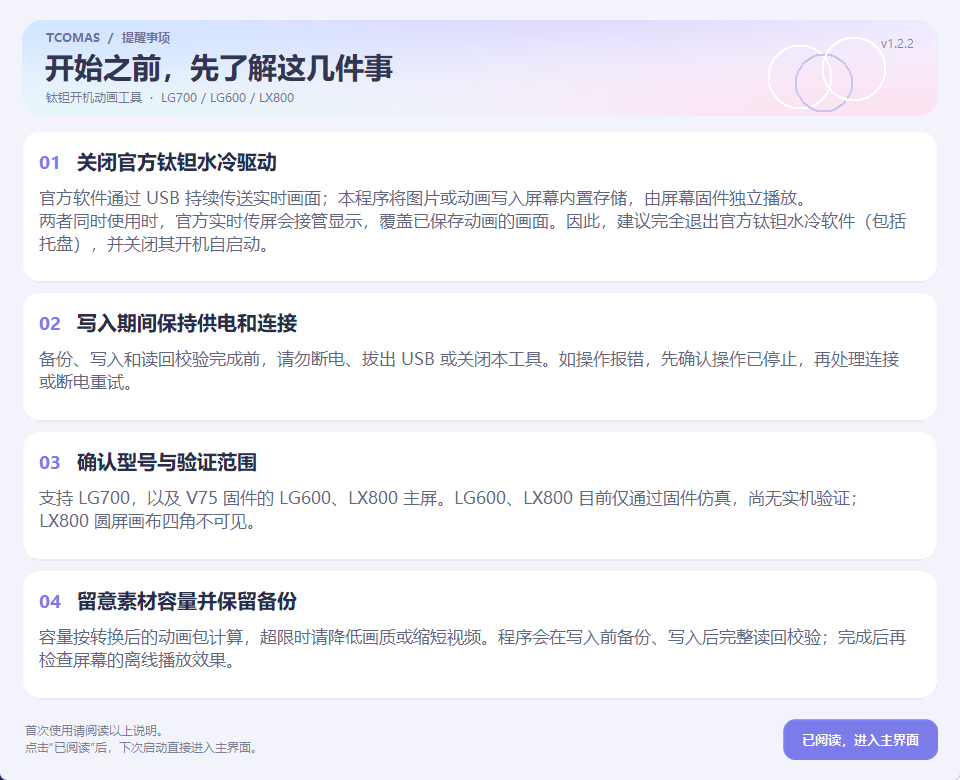
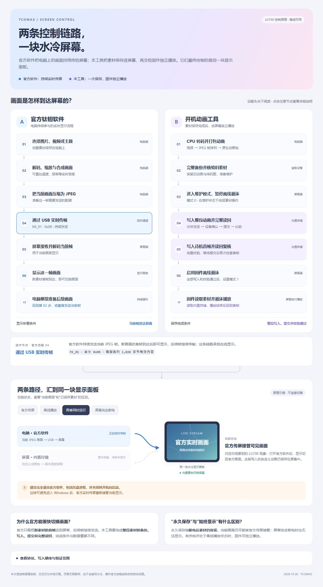

<h1 align="center">钛钽关机动画工具 · LG700 / LG600 / LX800</h1>

  把喜欢的图片与视频，留在你的水冷屏幕里。 
  <strong>写入屏幕内置存储 · 关机动画</strong> 
  

  
  
  
  

  <a href="https://github.com/GuoWQ222/TCOMAS-Boot-Animation-Tool/releases/latest"><strong>⬇ 下载便携版</strong></a>
  &nbsp; · &nbsp;
  <a href="#quick-start">快速开始</a>
  &nbsp; · &nbsp;
  <a href="#features">功能一览</a>
  &nbsp; · &nbsp;
  <a href="docs/screen-control-flow.html">控制原理流程图</a>
  &nbsp; · &nbsp;
  <a href="https://github.com/GuoWQ222/TCOMAS-Boot-Animation-Tool/issues">问题反馈</a>

  

## 💬 问题反馈 · Issues

遇到故障或报错？请前往 [Issues 提交问题](https://github.com/GuoWQ222/TCOMAS-Boot-Animation-Tool/issues/new)，**完整描述操作步骤、报错内容和出现问题的全过程**，便于定位原因。

> [!IMPORTANT]
> 报错后，先确认当前操作已经停止，再正常关机并断电（拔掉电源线）。**确保水冷屏幕完全黑屏后，再重新上电。** 主机重启不一定切断屏幕供电；写入过程中请勿断电。

## 🖥️ 程序预览

当前源码为 **v1.2.2**，包含多型号适配、新版界面与首次使用提醒页。

界面采用蓝紫粉柔和渐变、圆角卡片和重新绘制的按钮、画质滑块与进度条。窗口放大或最大化时，字号、控件及预览随可用区域缩放；预览保持对应型号的显示比例。

**提醒事项仅在首次使用时显示**，点击“已阅读”后记住状态，以后直接进入主界面。主界面右上方的“提醒事项”按钮可随时重新打开说明，返回后保留素材、画质和型号选择。设置保存在 `%LOCALAPPDATA%\TCOMAS-LG700-Tool\ui-preferences.json`。

已删除“停止官方传屏”选项及自动退出、监控、重启官方软件的逻辑。设备操作期间保留临时暂停和结束后恢复的机制。需要查看硬件保存的动画时，请手动完全退出官方软件；其在线传屏可能覆盖当前可见画面。见 [官方传屏与硬件动画说明](docs/vendor-control.md)。

v1.1.0 新增 LG600、LX800 型号适配。**这两款目前通过 V75 官方固件的离线仿真，尚无实机验证，不能承诺所有设备都成功。**

| 型号 | USB VID:PID | JPEG 编码尺寸 | 可视形状 | 允许写入的固件 REV | 验证范围 |
| --- | --- | --- | --- | --- | --- |
| LG700 | `1A2C:151C` | 640×480 | 矩形 | `0067`、`0075` | 0067 有历史实机记录；0075 为固件核对 |
| LG600 | `1A2C:1520` | 480×480 | 方形 | `0075` | 官方 V75 固件仿真；无实机 |
| LX800 | `1A2C:151D` | 480×480 | 圆形 | `0075` | 官方 V75 固件仿真；无实机 |

LX800 的 480×480 是编码画布，圆外四角在面板上不可见。预览采用圆形遮罩，JPEG 文件仍保持原厂 480×480 格式，重要内容请放在圆内。本适配针对圆形主屏，不包含侧面状态小屏。NEOX 不属于本协议系列，未加入支持。

详见 [LG600 / LX800 适配与验证](docs/multi-model-validation.md)。

  

## 🧭 屏幕控制原理

官方软件由电脑持续通过 USB 发送实时画面；本工具将整段素材写入屏幕内置存储，完成校验后由固件独立播放。两者可能争用同一块显示面板；官方实时画面接管显示，并不表示已保存的动画被删除。

- [查看交互流程图 HTML](docs/screen-control-flow.html)：下载该文件后用浏览器打开，无需联网。支持点击节点查看解释、切换四种屏幕工作状态。
- [下载单文件 HTML](https://raw.githubusercontent.com/GuoWQ222/TCOMAS-Boot-Animation-Tool/main/docs/screen-control-flow.html)：另存为 `.html` 后打开。GitHub 文件页通常显示源码。
- [官方软件与硬件动画说明](docs/vendor-control.md)。

## 🚀 下载和使用

1. **下载并解压**：从 [Releases](https://github.com/GuoWQ222/TCOMAS-Boot-Animation-Tool/releases/latest) 下载名称以 `windows-x64.zip` 结尾的便携包，完整解压到同一个文件夹。
2. **连接并运行**：连接支持型号，运行 `LG700Tool.exe`。首次先阅读提醒事项并点击“已阅读”，再等待自动识别；后续启动直接进入主界面，可从右上方重新查看提醒。连接多个型号时，可在“目标型号”中选择；也可以不连接设备、选择型号进行本地预览。
3. **设置并写入**：按需调节转换画质；想去掉黑边时，先勾选“等比裁剪铺满屏幕”（默认不勾选，保留完整画面）。将鼠标停在右侧“？”上可查看说明。再点击“写入自定义视频”，选择本地视频或图片；程序会自动转换、检查容量、备份现有素材、写入、完整读回比较，并设置离线播放模式。
4. **等待并查看**：操作完成后，真正切断屏幕供电再开机，观察进入 Windows 前的显示效果。

  

> [!TIP]
> **便携包已包含 Python 运行环境与 FFmpeg，无需另外安装。** 图片为单帧常驻，视频为多帧循环；视频首帧会自动保存为静态回退图。写入后可关闭本工具。

> [!NOTE]
> 写入耗时参考约 **3 分钟**，实际取决于素材大小、备份和读回过程。请等待操作完成，期间不要断电或拔出设备。

## ✨ 功能一览

| 功能 | 说明 |
| :--- | :--- |
| 🔎 **设备识别** | 识别水冷型号、固件 REV，以及硬件中已保存的动画大小。 |
| 🎬 **当前素材读取** | 读取 T'OWEI 中当前选中的图片或视频，需要该软件留下的配置与可访问的本地素材。**只使用本地文件时，无需安装原厂软件。** |
| 🎨 **画质与预览** | 支持本地动画预览；拖动转换画质滑块后，计算真实的硬件动画包大小，超限明确报错。 |
| 🖼️ **等比裁剪铺满** | 默认将完整画面放入编码画布；勾选后居中裁剪至对应型号尺寸，不拉伸。LX800 的圆外四角不可见，预览模拟圆屏边界。预览、大小计算和写入采用相同设置。 |
| 💾 **自动备份** | 写入前自动保存现有开机动画和待机图；首次原始备份单独保留，可恢复原始素材。 |
| 🛡️ **离线写入保护** | 完整备份后暂停原生循环，写入和校验通过后恢复；失败时停止，不自动重发擦写。 |
| ✅ **完整校验** | 写入后全量读回，逐字节比较；目标内容相同时，完整核验后跳过重复擦写。 |
| 🔁 **转换复用** | 预览与写入共享同一份转码结果，避免重复转换。 |
| 🛠️ **离线播放修复** | 修复已经保存动画的离线播放模式，无需重新转换或重写动画。 |
| ⏸️ **原厂传屏协调** | 设备会话期间临时暂停官方主进程，结束或异常后恢复；不自动结束、监控或重启官方软件。 |
| 🔌 **通信校验** | Windows 接收缓冲为 512 个报告，命令之间保留 10 毫秒处理间隔；保留 **8,192 字节**读写分块、严格响应检查、有限只读重试和重连后的完整读回。擦写和提交命令不自动重发。 |

FFmpeg 继续采用 CPU 转码；未加入 GPU 探测或硬件编码。

只读诊断：`LG700Tool.exe --inspect --model lx800 --output device-info.json`。型号还可选 `auto`、`lg700`、`lg600`。该命令读取版本和素材元数据，不写入素材。
