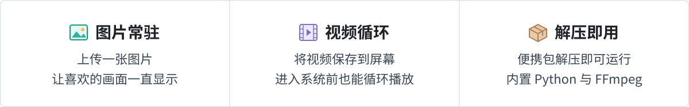
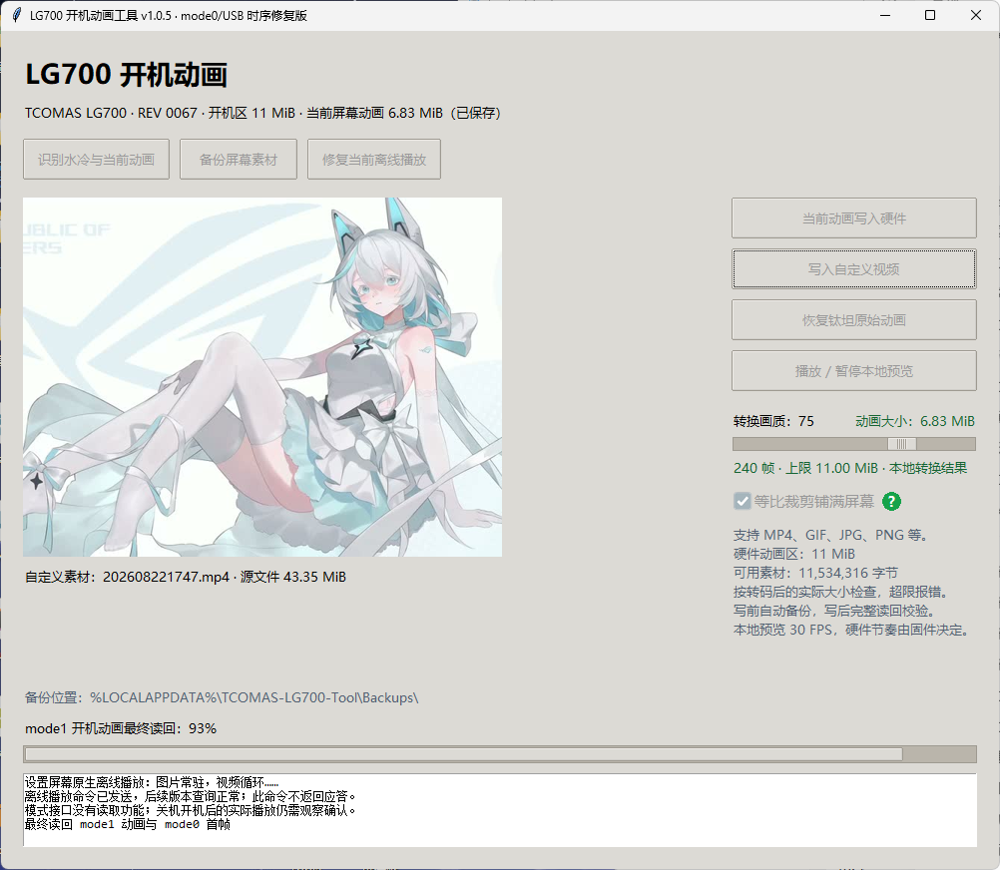

<h1 align="center">钛钽关机动画工具 · LG700 / LG600</h1>

  把喜欢的图片与视频，留在你的水冷屏幕里。 
  <strong>写入屏幕内置存储 · 关机动画</strong> 
  

  
  
  
  

  <a href="https://github.com/GuoWQ222/TCOMAS-Boot-Animation-Tool/releases/latest"><strong>⬇ 下载便携版</strong></a>
  &nbsp; · &nbsp;
  <a href="#quick-start">快速开始</a>
  &nbsp; · &nbsp;
  <a href="#features">功能一览</a>
  &nbsp; · &nbsp;
  <a href="https://guowq222.github.io/TCOMAS-Boot-Animation-Tool/screen-control-flow.html">控制原理流程图</a>
  &nbsp; · &nbsp;
  <a href="https://github.com/GuoWQ222/TCOMAS-Boot-Animation-Tool/issues">问题反馈</a>

  

## 💬 问题反馈 · Issues

遇到故障或报错？请前往 [Issues 提交问题](https://github.com/GuoWQ222/TCOMAS-Boot-Animation-Tool/issues/new)，**完整描述操作步骤、报错内容和出现问题的全过程**，便于定位原因。

> [!IMPORTANT]
> 报错后，先确认当前操作已经停止，再正常关机并断电（拔掉电源线）。**确保水冷屏幕完全黑屏后，再重新上电。** 主机重启不一定切断屏幕供电；写入过程中请勿断电。

## 🖥️ 程序预览

  

## 🚀 下载和使用

1. **下载并解压**：从 [Releases](https://github.com/GuoWQ222/TCOMAS-Boot-Animation-Tool/releases/latest) 下载名称以 `windows-x64.zip` 结尾的便携包，完整解压到同一个文件夹。
2. **连接并运行**：连接支持型号，运行 `LG700Tool.exe`。首次先阅读提醒事项并点击“已阅读”，再等待自动识别；后续启动直接进入主界面，可从右上方重新查看提醒。连接多个型号时，可在“目标型号”中选择；也可以不连接设备、选择型号进行本地预览。
3. **设置并写入**：按需调节转换画质；“等比裁剪铺满屏幕”默认勾选，会居中裁剪画面以铺满屏幕、不拉伸；想保留完整画面时可取消勾选。将鼠标停在右侧“？”上可查看说明。再点击“写入自定义视频”，选择本地视频或图片；程序会自动转换、检查容量、备份现有素材、写入、完整读回比较，并设置离线播放模式。
4. **等待并查看**：操作完成后，真正切断屏幕供电再开机，观察进入 Windows 前的显示效果。

  

> [!TIP]
> **便携包已包含 Python 运行环境与 FFmpeg，无需另外安装。** 图片为单帧常驻，视频为多帧循环；视频首帧会自动保存为静态回退图。写入后可关闭本工具。

> [!NOTE]
> 写入耗时参考约 **3 分钟**，实际取决于素材大小、备份和读回过程。请等待操作完成，期间不要断电或拔出设备。

## ✨ 功能一览

| 功能 | 说明 |
| :--- | :--- |
| 🔎 **设备识别** | 识别水冷型号、固件 REV，以及硬件中已保存的动画大小。 |
| 🎬 **硬件首帧识别** | 从屏幕已保存的动画包直接读取首帧，核对目录、JPEG 和两次读取一致性；不依赖官方配置、不读取整段动画，不捕获实时传屏。 |
| 🎨 **画质与预览** | 支持本地动画预览；拖动转换画质滑块后，计算真实的硬件动画包大小，超限明确报错。 |
| 🖼️ **等比裁剪铺满** | 默认勾选，居中裁剪至对应型号尺寸，不拉伸；取消勾选后保留完整画面。LX800 的圆外四角不可见，预览模拟圆屏边界。预览、大小计算和写入采用相同设置。 |
| 💾 **自动备份** | 写入前自动保存现有开机动画和待机图；首次原始备份单独保留，可恢复原始素材。 |
| 🛡️ **离线写入保护** | 完整备份后暂停原生循环，写入和校验通过后恢复；失败时停止，不自动重发擦写。 |
| ✅ **完整校验** | 写入后全量读回，逐字节比较；目标内容相同时，完整核验后跳过重复擦写。 |
| 🔁 **转换复用** | 预览与写入共享同一份转码结果，避免重复转换。 |
| 🛠️ **离线播放修复** | 修复已经保存动画的离线播放模式，无需重新转换或重写动画。 |
| ⏸️ **原厂传屏协调** | 设备会话期间临时暂停官方主进程，结束或异常后恢复；不自动结束、监控或重启官方软件。 |
| 🔌 **通信校验** | Windows 接收缓冲为 512 个报告，命令之间保留 10 毫秒处理间隔；保留 **8,192 字节**读写分块、严格响应检查、有限只读重试和重连后的完整读回。擦写和提交命令不自动重发。 |
